<p align="center"></p>

<h1 align="center">Rubi · روبی</h1>

<p align="center"><b>روبی | دستیار هوشمند همه‌جانبه‌ی شما</b><br/><i>Rubi | Your all-in-one smart assistant</i></p>

<p align="center">
  
  
  
  
  
</p>

<h2 align="center"><a href="https://github.com/M-Mashreghi/Rubi/releases/latest">⬇️ دانلود آخرین نسخه · Download the latest release</a></h2>

<p align="center"><b><a href="#-نصب">📥 راهنمای نصب</a> · <a href="#-انتقال-اطلاعات-از-افزونه‌ی-دستیار">🔄 انتقال از دستیار</a> · <a href="#-install">📥 Install guide</a> · <a href="#-move-your-data-from-dastyar">🔄 Move from Dastyar</a></b></p>

<p align="center"><a href="#فارسی">فارسی</a> · <a href="#english">English</a></p>

<p align="center"></p>

---

<div dir="rtl">

## فارسی

روبی یک **تب جدید شخصی** برای گوگل کروم است. هر بار که تب جدید باز می‌کنید، تقویم، کارهای امروز، یادداشت‌ها، میان‌برها، آب‌وهوا و نرخ ارز جلوی چشمتان است. روبی **هیچ تبلیغ و هیچ ردیابی ندارد** و اطلاعاتتان فقط در مرورگر و **حساب گوگل خودتان** ذخیره می‌شود.

### صفحه‌ی اصلی

همه‌چیز در یک صفحه، بدون اسکرول: ساعت و تاریخ، آب‌وهوا، مناسبت امروز، نرخ ارز و طلا، تقویم ماه، جستجو و میان‌برها، و پنل کارها و یادداشت‌ها.

<p align="center"></p>

روبی در استفاده‌ی واقعی، با عکس پس‌زمینه‌ی دلخواه و نرخ‌های زنده:

<p align="center"></p>

### یار هوشمند و حال خوب روزانه

- **پرسیدن از هوش مصنوعی:** دکمه‌ی ✨ کنار جستجو، سؤال را مستقیم به Claude، ChatGPT، Gemini، Perplexity، DeepSeek یا Kimi می‌فرستد. با **Shift+Enter** سؤال به آخرین هوش مصنوعی‌ای که انتخاب کرده‌اید می‌رود.
- **جمله‌ی امیدبخش روز:** هر روز یک جمله‌ی انگیزشی و امیدبخش تازه؛ با ↻ جمله‌ی بعدی را ببینید.
- **شعر روز و فال حافظ:** هر روز یک بیت از حافظ، و فال حافظ با غزل کامل و تعبیر آن.
- **بعداً بخوانم:** لینک‌ها را از پنل کناری یا با **راست‌کلیک روی هر صفحه** ذخیره کنید.
- **ردیاب عادت‌ها:** آب خوردن، ورزش، مطالعه و هر عادت دیگر، با هدف روزانه، نمای ۷ روزه و شمارش روزهای پشت‌سرهم 🔥.
- **انتخاب نرخ‌ها:** در تنظیمات انتخاب کنید کدام ارز، طلا یا رمزارز در نوار نرخ‌ها دیده شود.
- **☀️ مرور صبحگاهی:** هر روز صبح یک کارت که کارهای امروز و عقب‌افتاده، رویدادها و تولدها، آب‌وهوا، مناسبت روز، عادت‌ها و جمله‌ی روز را یک‌جا نشان می‌دهد.
- **🎯 حالت تمرکز:** با یک دکمه فقط ساعت، جستجو و پومودورو می‌ماند و سایت‌های حواس‌پرت‌کن (اینستاگرام، یوتیوب، X و …) تا وقتی تمرکز روشن است بسته می‌شوند. فهرست سایت‌ها دست خودتان است.
- **📈 سهام و شاخص‌ها:** قیمت انویدیا، اپل، S&P 500، نزدک و هر نماد دلخواه بورس آمریکا کنار نرخ ارز (فقط برای نمایش).
- **💸 ردیاب هزینه:** خرج‌ها به تومان، دلار، یورو و … با دسته‌بندی، جمع ماهانه (بر اساس تقویم اصلی شما) و نمودار سهم هر دسته.
- **🎧 صداهای تمرکز:** ۱۴ صدای آرامش‌بخش (باران، رعدوبرق، باد، موج دریا، رودخانه، آتش هیزم، کافه، شب تابستان، پرندگان، قطار، نویز سفید، صورتی و قهوه‌ای، و بیت آلفا) که می‌شود ترکیبشان کرد. ۸ ترکیب آماده مثل «کافه‌ی بارانی» و «شب بارانی کنار آتش» هم دارد، با تایمر خاموشی. صداها در پس‌زمینه پخش می‌شوند و با رفتن به سایت‌های دیگر قطع نمی‌شوند. همه‌ی صداها همان لحظه در خود مرورگر ساخته می‌شوند، پس فایل صوتی دانلود نمی‌شود و اینترنت هم لازم نیست.
- **🔔 هشدار قیمت:** مثلاً «بیت‌کوین زیر ۹۰٬۰۰۰ دلار» یا «انویدیا بالای ۲۰۰ دلار». کروم اعلان می‌دهد، حتی اگر صفحه‌ی روبی باز نباشد.
- **📋 قطعه‌متن‌ها:** آدرس، جواب‌های آماده و متن‌های پرتکرار با یک کلیک کپی می‌شوند. در هر سایتی هم با راست‌کلیک در جعبه‌ی متن، همان‌جا نوشته می‌شوند.
- **🖨 تقویم برای چاپ:** ماه شمسی با مناسبت‌ها، رویدادها و کارهای خودتان. چاپ کنید یا PDF بگیرید.
- **🎵 این آهنگ چیه؟:** چند ثانیه گوش می‌دهد و اسم آهنگ و خواننده را با لینک اسپاتیفای، یوتیوب و اپل موزیک نشان می‌دهد. برای این کار کلید رایگان [AudD](https://dashboard.audd.io/) لازم است.
- **📊 گزارش تمرکز:** هر روز چند جلسه‌ی پومودوروی ۲۵ دقیقه‌ای داشته‌اید، چقدر تا هدف روزانه مانده، نمودار ۷ روز اخیر، روزهای پشت‌سرهم و بهترین روز.
- **🗓 خلاصه‌ی هفتگی:** آخر هفته (جمعه شب) یک کارت باز می‌شود با کارهای انجام‌شده، جلسه‌های تمرکز، عادت‌ها و خرج هفته.
- **🎯 بودجه‌ی ماهانه:** برای هر دسته‌ی هزینه سقف بگذارید. در ۸۰٪ و ۱۰۰٪ سقف هشدار می‌گیرید.
- **🧮 ماشین‌حساب و مبدل در جستجو:** مثلاً «۱۲۰ دلار به تومان»، «۵ فوت به سانتی‌متر»، «۳۰ c to f» یا «۱۲×(۳+۴)». جواب همان زیر جعبه‌ی جستجو می‌آید و با یک کلیک کپی می‌شود.
- **دو نوار کناری:** ابزارهای اصلی سمت راست، و صداها، تمرکز، مرور روز و هوش مصنوعی‌ها سمت چپ.
- **💧👀 یادآور آب و استراحت چشم:** هر چند وقت یک کارت کوچک کنار صفحه (چپ یا راست، به انتخاب شما) می‌آید که با ✕ بسته می‌شود: «یک لیوان آب بنوشید» یا «۲۰ ثانیه به دوردست نگاه کنید» با شمارش معکوس. لیوان‌های امروز شمرده می‌شوند. وقتی روبی باز نیست، اعلان کروم می‌آید. شب‌ها و وقتی پشت کامپیوتر نیستید چیزی نمی‌آید.
- **📁 پوشه داخل پوشه:** پوشه‌ها می‌توانند داخل هم باشند، با مسیر بالای پوشه برای برگشتن.
- **🪟 شفافیت باکس‌ها:** در تنظیمات › پس‌زمینه، وقتی عکس یا ویدئوی پس‌زمینه دارید، شفافیت باکس‌ها را تنظیم کنید؛ یک مقدار برای حالت عادی (پیش‌فرض ۶۰٪) و یکی برای وقتی ماوس روی باکس است (پیش‌فرض ۸۵٪، پررنگ‌تر).
- **👋 راه‌اندازی اول کار:** بار اول چند سؤال کوتاه می‌پرسد: زبان، آوردن اطلاعات قبلی (حساب گوگل و درایو، دستیار، فایل پشتیبان)، نام و تولد، شهر، پوسته و تصویر زمینه و باکس‌ها. بعد گشت کوتاه شروع می‌شود.
- **🇮🇷 سایت‌های ایرانی در سرویس‌ها:** نزدیک ۲۷۰ سایت در ۲۴ دسته (دولتی، بانک، بیمه، تاکسی و مسیریاب، خبر، فیلم، پیام‌رسان، فروشگاه، سلامت، هوش مصنوعی ایرانی و …). صفحه سه زبانه دارد (جهانی، ایرانی، دسته‌های من) و جستجوی سایت. هر دسته را می‌شود خاموش کرد یا دسته‌ی دلخواه ساخت و سایت به آن اضافه کرد.
- **🕌 یادآور نماز:** (پیش‌فرض خاموش؛ تنظیمات › تقویم و زمان) وقتی وقت نماز صبح، ظهر و عصر یا مغرب و عشا باز است، کارتی کنار صفحه با شمارش معکوس تا پایان وقت.
- **🧩 باکس‌ها و قابلیت‌ها:** هر باکس را با ✕ گوشه‌اش خاموش کنید و از دکمه‌ی 🧩 بالای صفحه‌ی ابزارها یا تنظیمات › عمومی دوباره روشن کنید. دکمه‌های نوار کناری، یادآورها، پوسته‌ی مناسبتی و میان‌برهای هوشمند هم همان‌جا روشن و خاموش می‌شوند.
- **🎥 هوش مصنوعی ویدیو:** دسته‌ی تازه در صفحه‌ی سرویس‌ها: Sora، Veo/Flow، Runway، Kling، Luma، Pika، Hailuo و …
- **👋 آموزش اولین اجرا:** چند قدم کوتاه که بخش‌های اصلی را نشان می‌دهد. از تنظیمات › درباره دوباره دیده می‌شود.
- **🎁 خبر نسخه‌ی جدید:** وقتی نسخه‌ی تازه‌ای منتشر شود، بالای صفحه خبر می‌دهد و مراحل به‌روزرسانی را نشان می‌دهد.
- **⏳ شمارش معکوس برای هر چیزی:** سفر، پایان ترم، پایان سال، پایان تابستان، نوروز، یلدا و … با دکمه‌های آماده که تاریخ را خودشان حساب می‌کنند، و عکس دلخواه در صفحه‌ی اصلی.
- **🎯 اهداف بلندمدت:** مثلاً «۱۲ کتاب امسال» یا «۵۰۰ کیلومتر دویدن»، با نوار پیشرفت و پیش‌بینی اینکه با همین سرعت به هدف می‌رسید یا نه، و اینکه روزی یا هفته‌ای چقدر لازم است.
- **🙏 دفتر شکرگزاری:** هر شب سه خط، با یادآوری کوچک و مرور ماهانه.
- **🌍 ساعت جهانی:** چند شهر کنار هم، با اختلاف ساعت و روز و شب.
- **🌫️ کیفیت هوا:** شاخص AQI و PM2.5 کنار آب‌وهوا، با هشدار در روزهای آلوده.
- **🧠 میان‌برهای هوشمند:** اگر روشن کنید، میان‌برهایی که در این ساعت از روز بیشتر باز می‌کنید جلوتر می‌آیند.
- **🎉 پوسته‌ی مناسبتی:** در نوروز، یلدا، چهارشنبه‌سوری، محرم و کریسمس ظاهر صفحه خودش کمی عوض می‌شود.
- **🌐 مترجم سریع:** با Alt+T (یا L) باز می‌شود؛ فارسی ↔ انگلیسی، آلمانی و زبان‌های دیگر.
- **⚽ فوتبال:** نتیجه‌ی آخرین بازی‌ها و بازی بعدی تیم‌های محبوبتان (پرسپولیس، استقلال، تیم ملی، رئال مادرید و …).
- **👨‍👩‍👧 تقویم خانوادگی:** تولدها و رویدادها را با یک کد یا فایل برای خانواده بفرستید تا در روبی خودشان اضافه کنند.

<p align="center"></p>
<p align="center"></p>
<p align="center"></p>
<p align="center"></p>
<p align="center"></p>
<p align="center"></p>
<p align="center"></p>
<p align="center"></p>
<p align="center"></p>
<p align="center"></p>
<p align="center"></p>
<p align="center"></p>
<p align="center"></p>
<p align="center"></p>
<p align="center"></p>
<p align="center"></p>
<p align="center"></p>
<p align="center"></p>
<p align="center"></p>
<p align="center"></p>
<p align="center"></p>
<p align="center"></p>
<p align="center"></p>
<p align="center"></p>
<p align="center"></p>
<p align="center"></p>
<p align="center"></p>
<p align="center"></p>
<p align="center"></p>
<p align="center"></p>
<p align="center"></p>
<p align="center"></p>

### 🎈 سرگرمی

از دکمه‌ی 🎈 در نوار کناری یک صفحه‌ی تازه باز می‌شود، پر از چیزهای بامزه و دوست‌داشتنی. همه‌اش داخل خود روبی ساخته می‌شود و چیزی از اینترنت دریافت نمی‌کند.

- **📅 امروز در تاریخ:** رویدادها، زادروزها و درگذشت‌های مهم ایران و جهان در همین روز؛ هر رویداد با تاریخ **شمسی و میلادی** خودش و اینکه چند سال پیش بوده. مناسبت‌های روز، نام روز در **گاه‌شماری ایران باستان** (مثلاً «روز خرداد از ماه آذر») و جشن‌های کهن مثل تیرگان و آذرگان، آسمان روز (برج خورشید، شکل ماه، طول روز در شهر شما، چندمین روز سال) و یک «می‌دانستید؟» تازه. با ‹ › روزهای دیگر را ببینید یا به هر تاریخی بروید. در صفحه‌ی اصلی هم زبانه‌ی «📅 امروز» دارد.
- **🎉 جشن‌های خودکار:** روز تولد شما، نوروز، سیزده‌به‌در، چهارشنبه‌سوری، شب یلدا و سال نو میلادی. اولین تب آن روز یک صحنه‌ی جشن با کنفتی، آتش‌بازی، گلبرگ یا اخگر باز می‌کند و صفحه تمام روز ظاهر مخصوص خودش را دارد:
  - **تولد:** کیک با شمع‌های سن شما که با یک کلیک فوت می‌شوند، بادکنک و آهنگ تولد.
  - **نوروز:** سفره‌ی هفت‌سین با ماهی قرمز و سبزه، و **لحظه‌ی دقیق تحویل سال** (با محاسبه‌ی نجومی اعتدال بهاری) با شمارش معکوس ثانیه‌به‌ثانیه؛ از ۲۵ اسفند شمارش معکوس روی صفحه‌ی اصلی هم دیده می‌شود.
  - **چهارشنبه‌سوری:** آتش و اخگر؛ با «بپر» از روی آتش بپرید: «زردی من از تو، سرخی تو از من».
  - **یلدا:** ماه و ستاره، هندوانه و اناری که با یک کلیک باز می‌شود، طول بلندترین شب در شهر شما و فال حافظ یلدایی.
  - **سیزده‌به‌در:** سبزه‌ای که گره می‌زنید و آرزو می‌کنید.
  - در صفحه‌ی سرگرمی فهرست جشن‌های پیش رو با شمارش روزها و دکمه‌ی ▶ پیش‌نمایش هر کدام هست. صدای جشن پیش‌فرض خاموش است.
- **🪶 ضرب‌المثل و شعر روز:** هر روز یک ضرب‌المثل یا بیتی از فردوسی، سعدی، مولوی، حافظ، خیام، نیما، سهراب، فروغ و … با **معنی** آن. با «📸 تصویر استوری» یک تصویر ۱۰۸۰×۱۹۲۰ با شش طرح رنگی و چهار قلم فارسی بسازید و ذخیره، کپی یا مستقیم هم‌رسانی کنید.
- **🎮 بازی‌های استراحت:** ۲۰۴۸ و مار. وقتی یک دور تمرکز تمام شود، به اندازه‌ی زمان استراحت باز می‌شوند و یک کارت «وقت استراحت!» دعوتتان می‌کند؛ وقت استراحت که تمام شد پیشنهاد برگشت به تمرکز می‌دهند (اگر بخواهید اول دستتان را تمام می‌کنید). با کلیدهای جهت یا کشیدن انگشت بازی می‌شوند، رکوردها نگه داشته می‌شود و اگر بخواهید می‌توانید آنها را همیشه باز بگذارید.
- **🐾 حیوان خانگی:** پیش‌فرض خاموش است و روبی فقط یک بار می‌پرسد که می‌خواهید یا نه. گربه، سگ، طوطی، خرگوش، روباه، پاندا، پنگوئن یا همستر؛ اسم و گوشه‌ی صفحه‌اش را انتخاب کنید. با هر کار انجام‌شده، عادت، دور تمرکز و یادداشت سپاس‌گزاری بزرگ‌تر می‌شود (در سطح ۳ شال‌گردن، ۵ کلاه، ۷ عینک و ۱۰ تاج می‌گیرد)، پلک می‌زند، با چشم‌هایش موس شما را دنبال می‌کند، در صفحه راه می‌رود، شب‌ها می‌خوابد، با نوازش قلب می‌فرستد، غذا می‌خواهد و برای کارهایتان ذوق می‌کند. هر حیوان صدای خودش را دارد (میو و خرخر گربه، واق‌واق سگ، سوت طوطی، جیغ روباه، بوق پنگوئن، جیرجیر همستر و …) که داخل مرورگر ساخته می‌شود و فقط وقتی با او بازی می‌کنید پخش می‌شود، و حرکت‌های مخصوص خودش: گربه می‌پرد و کش‌وقوس می‌آید، سگ دور خودش می‌دود و پشتک می‌زند، طوطی می‌رقصد و سر تکان می‌دهد، خرگوش جست‌وخیز می‌کند، روباه دنبال دمش می‌چرخد، پاندا قل می‌خورد، پنگوئن تاتی‌تاتی می‌کند و روی شکم سُر می‌خورد. برای دیدن نمایش روی حیوان دوبار کلیک کنید یا 🎪 را بزنید. هر وقت بخواهید خاموشش کنید؛ پیشرفتش می‌ماند.
- **🔭 آسمان شب:** شکل امشب ماه (با تصویر دقیق هلال)، درصد روشنایی و سن ماه، تاریخ ماه کامل و ماه نو بعدی، طلوع و غروب شهر شما، و فهرست رویدادهای پیش رو در آسمان: بارش‌های شهابی (برساوشی، جوزایی، …) با تعداد شهاب در ساعت و خورشیدگرفتگی‌ها و ماه‌گرفتگی‌های ۲۰۲۶ تا ۲۰۲۸، با تاریخ شمسی و میلادی.
- **✨ طالع و برج من:** برج شما از روی تاریخ تولد (حمل، ثور، …) با عنصر، سیاره‌ی حاکم و ویژگی‌ها؛ طالع روزانه (امروز، دوستی و عشق، کار)، عدد و رنگ شانس و حال‌وهوای روز که برای هر برج تمام روز ثابت است؛ و سال حیوانی تولد شما و امسال در گاه‌شماری ایرانی (موش، گاو، پلنگ، … ۱۴۰۵ سال اسب). فقط برای سرگرمی!
- **🎭 تغییر صدا:** تا ۳۰ ثانیه صدایتان را ضبط کنید یا یک فایل صوتی باز کنید و آن را با ۱۵ افکت بشنوید: ربات، دختر، زن، مرد، بچه، هیولا، خرس، گربه، پرنده، آدم فضایی، پژواک کوه، غار، رادیو، تلفن و برعکس. نتیجه را به‌صورت WAV ذخیره یا هم‌رسانی کنید. صدا فقط داخل همان صفحه پردازش می‌شود.
- **📷 پس‌زمینه‌ی زنده با دوربین:** پیش‌فرض خاموش؛ با روشن کردنش (در صفحه‌ی سرگرمی یا تنظیمات › پس‌زمینه) کروم اجازه‌ی دوربین می‌خواهد و تصویر زنده‌ی شما پشت روبی پخش می‌شود، آینه‌ای یا نه، با حالت‌های طبیعی، کمی محو، سیاه‌وسفید، قدیمی، نئون و رؤیایی. تصویر ضبط یا فرستاده نمی‌شود و با بیرون رفتن از تب دوربین خاموش می‌شود.
- **💌 کپسول زمان:** برای خودِ آینده‌تان نامه بنویسید و روز باز شدنش را انتخاب کنید (یک ماه، شش ماه، یک سال، پنج سال، نوروز بعد یا تولد بعدی). نامه تا آن روز مهر و موم می‌ماند و حتی خودتان هم نمی‌توانید بخوانیدش؛ روزش که برسد با پاکت و کنفتی می‌رسد. نامه‌ها همراه بقیه‌ی داده‌های روبی در گوگل درایو خودتان پشتیبان گرفته می‌شوند و روی کامپیوتر تازه برمی‌گردند.
- **🔮 فال و طالع:** کارت تاروت روز و فال سه‌کارتی (گذشته، حال، آینده)؛ فال قهوه از عکس فنجان (روبی نقش‌های تیره‌ی فنجان را پیدا می‌کند و برای هر کدام نمادی می‌خواند، عکس فقط داخل صفحه بررسی می‌شود)؛ توپ جادویی برای سؤال‌های آره یا نه؛ و فال حافظ.
- **🧘 تمرین تنفس:** دایره‌ای که با دم بزرگ و با بازدم کوچک می‌شود، با صدای ملایمی که همراه نفس اوج می‌گیرد. الگوهای آرام‌بخش، مربعی، ۴-۷-۸ برای خواب و متعادل، در ۱ تا ۱۰ دقیقه.
- **🏅 نشان‌ها و دستاوردها:** ۴۰ نشان برنزی، نقره‌ای و طلایی برای کارهایی که در روبی می‌کنید؛ مثل «۷ روز تمرکز پشت‌سرهم»، «۳۰ فال حافظ»، «۱۰۰ کار انجام‌شده»، «سحرخیز» یا «جشن یلدا با روبی». هر نشان تازه با کنفتی خبر داده می‌شود و می‌شود آن را به‌صورت تصویر استوری به اشتراک گذاشت.

<p align="center">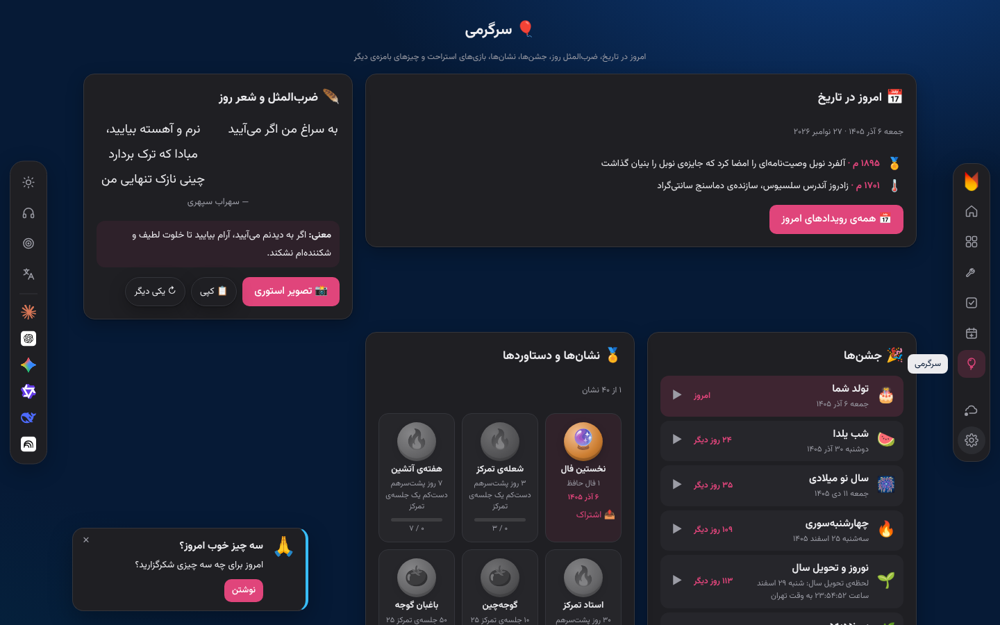</p>
<p align="center">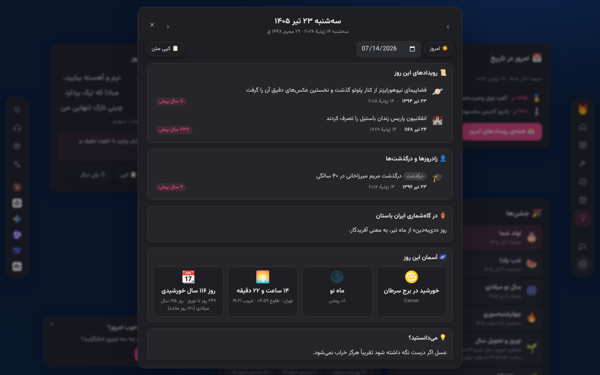</p>
<p align="center">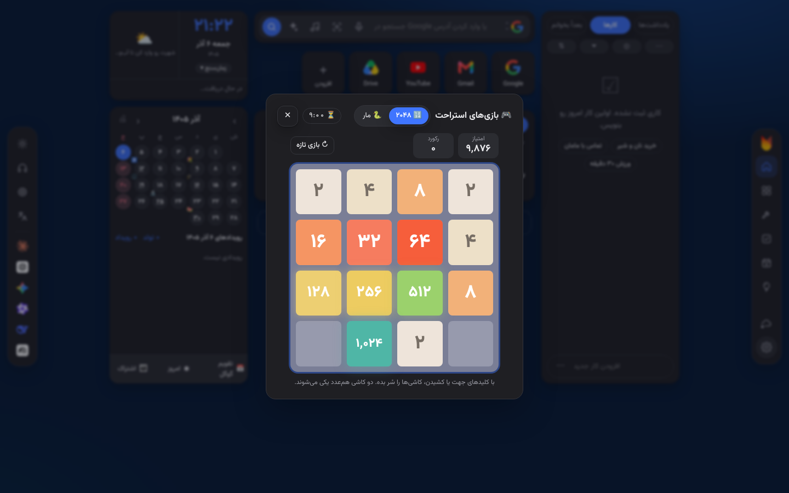 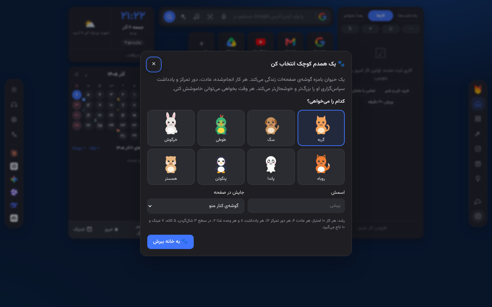</p>
<p align="center">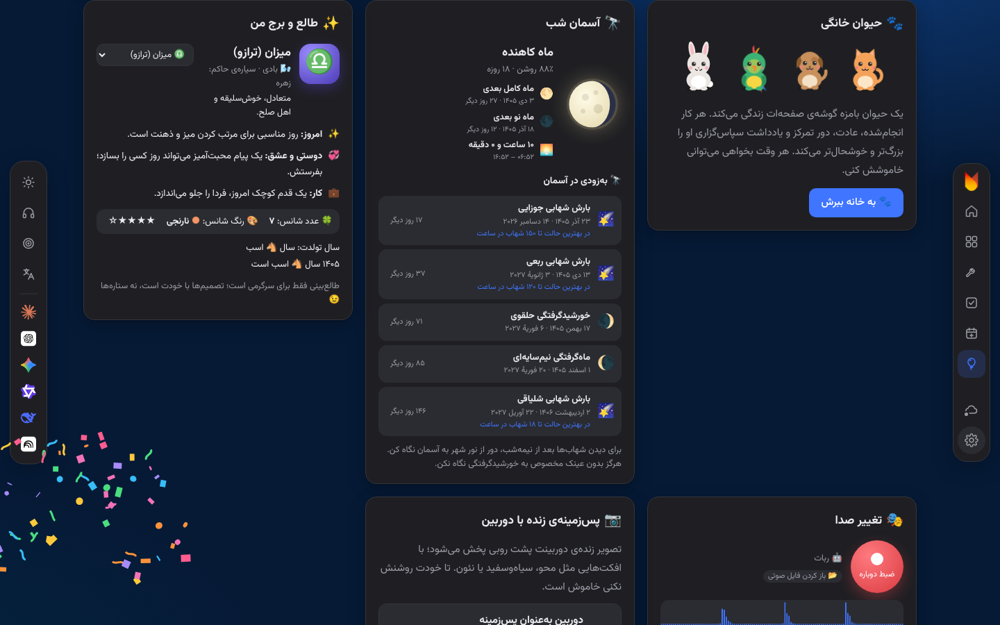</p>
<p align="center">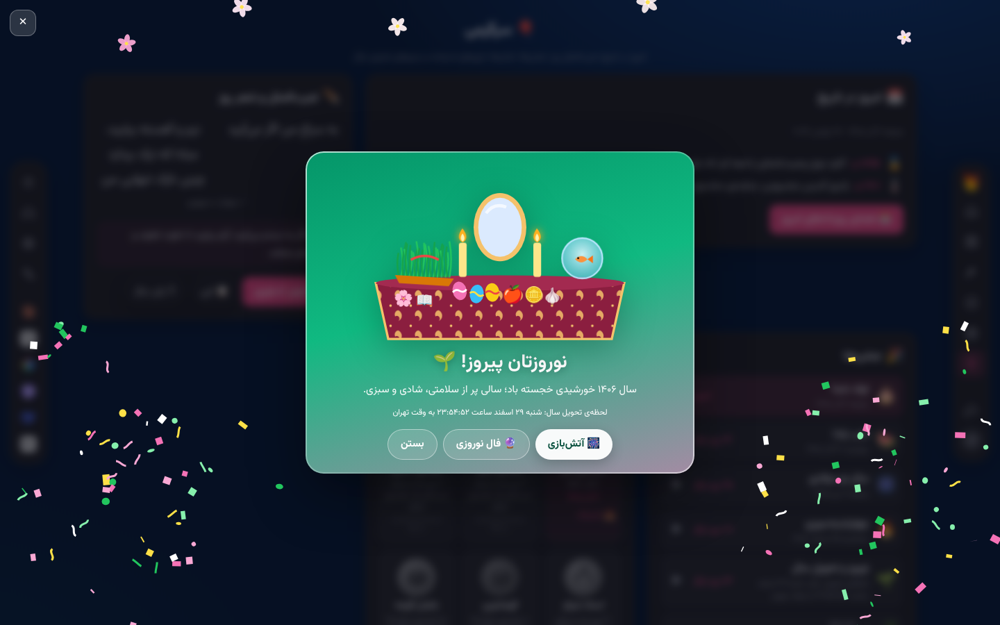</p>
<p align="center">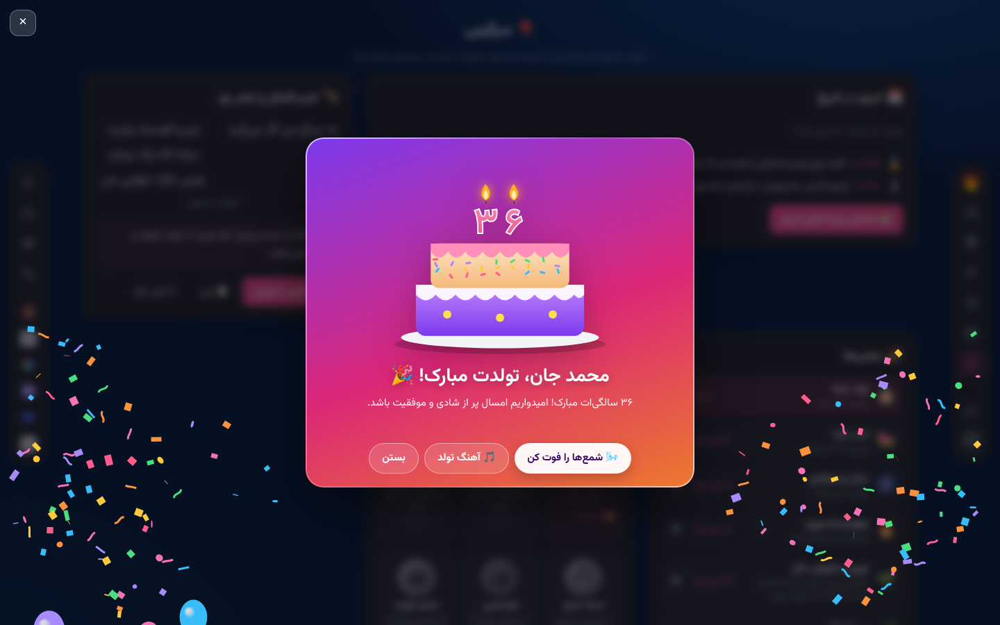</p>
<p align="center">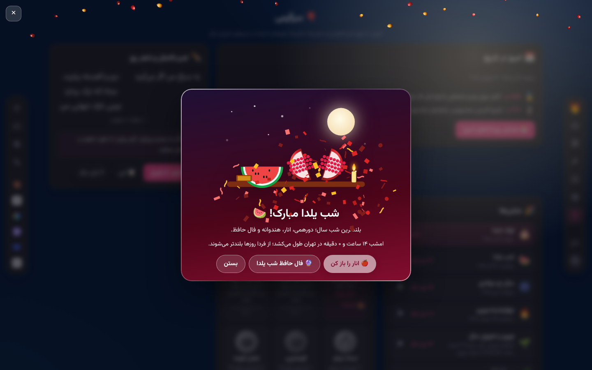</p>
<p align="center">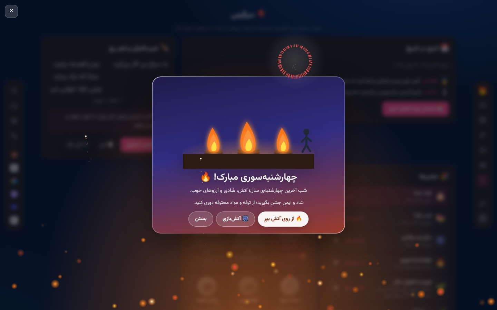</p>
<p align="center">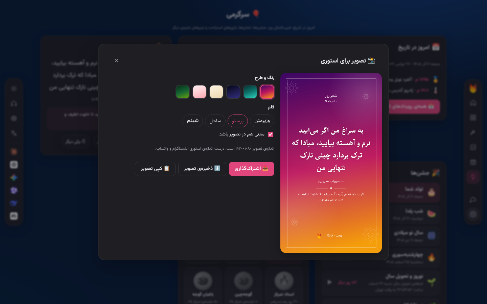</p>
<p align="center">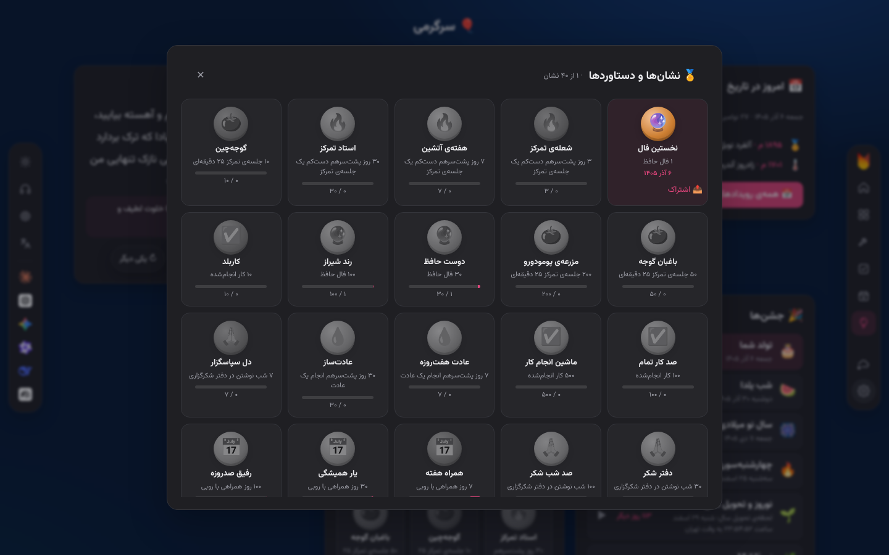</p>

### تقویم و مناسبت‌ها

- سه تقویم **شمسی، میلادی و قمری** که با هم نشان داده می‌شوند.
- **مناسبت‌های ایرانی و جهانی**، هر کدام با ایموجی خودش، روی تقویم و به‌صورت «مناسبت امروز» بالای صفحه.
- تعطیلات رسمی ایران، و روزهای متغیر مثل چهارشنبه‌سوری، عید پاک، روز مادر و روز پدر.
- ۱۲ دسته‌ی مناسبت (مذهبی، ملی، هنر، علم، ورزش، فناوری و …) که هر کدام جدا روشن یا خاموش می‌شوند.
- رویداد، تولد و یادآوری، با تکرار روزانه، هفتگی، ماهانه و سالانه.
- نمایش رویدادهای **تقویم گوگل** (اختیاری).

### برنامه‌ی هفتگی

با دکمه‌ی «کارها و یادداشت‌ها» در نوار کناری، برنامه‌ی هفته ساعت‌به‌ساعت باز می‌شود. رویدادها، کارهای ساعت‌دار و تولدها کنار هم دیده می‌شوند. با کلیک روی یک ساعت خالی، رویداد جدید در همان ساعت ساخته می‌شود.

<p align="center"></p>

### کارها و یادداشت‌ها

- کار با تاریخ، ساعت، اولویت، برچسب، یادآوری و تکرار.
- بوردهای جدا (مثلاً «کار» و «خانه»)، فیلتر و مرتب‌سازی، و صفحه‌ی کامل کارها.
- یادداشت‌های سریع با جستجو.

### میان‌برها و سرویس‌ها

- میان‌برها با **لوگوی واقعی هر سایت**، پوشه، کشیدن و جابه‌جا کردن، و منوی راست‌کلیک.
- صفحه‌ی سرویس‌ها با دسته‌بندی: **هوش مصنوعی** (Claude، ChatGPT، Gemini، DeepSeek، Qwen، NotebookLM و …)، **همه‌ی سرویس‌های گوگل**، سایت‌های ایرانی، خرید، سفر، فیلم، موسیقی، شبکه‌های اجتماعی، خبر، **خبرگزاری‌های آمریکا** (رویترز، AP، CNN، نیویورک تایمز و …)، **گیمینگ** (Steam، Epic، PlayStation، IGN و …)، **والپیپر** (Wallhaven، Wallpaper Abyss، Wallpaper Cave و …) و ابزار.
- دسترسی سریع به Claude، ChatGPT، Gemini، Qwen، DeepSeek و NotebookLM از نوار کناری.
- **صدای خوشامد** (پیش‌فرض خاموش): ۷ صدای ملایم هنگام باز شدن روبی، یا صدای دلخواه خودتان.
- **آواتار:** ۳۲ آواتار طراحی‌شده برای روبی (زن، مرد، دختر و پسر) برای انتخاب در راه‌اندازی اول یا تنظیمات › پروفایل؛ یا عکس خودتان.
- **پرچم کشور سایت** (پیش‌فرض خاموش): آیکون روبی در نوار افزونه‌ها به پرچم کشوری تبدیل می‌شود که سرور سایتِ باز در آن است، با لوگوی کوچک روبی در گوشه. کشور داخل خود افزونه پیدا می‌شود.

<p align="center"></p>

### ابزارها

آب‌وهوا، اوقات شرعی، نرخ ارز و طلا، پومودورو، تایمر، کرنومتر، شمارش معکوس، تبدیل تاریخ و محاسبه‌ی سن. جستجو با صدا و با عکس هم داخل خود صفحه است.

### تنظیمات

<table>
<tr>
<td></td>
<td></td>
</tr>
<tr>
<td></td>
<td></td>
</tr>
</table>

- **پروفایل:** عکس پروفایل، نام، نام کاربری و تاریخ تولد. ورود و خروج با حساب گوگل از طریق کروم.
- **پوسته و رنگ:** روشن، تیره، خودکار، روز و شب، به‌علاوه‌ی ۲۶ پوسته‌ی دیگر و ۷ رنگ اصلی یا رنگ دلخواه.
- **۱۳ فونت:** وزیرمتن، ساحل، شبنم، صمیم، تنها، پرستو، Inter، Lora، JetBrains Mono و … همه داخل افزونه، بدون نیاز به اینترنت.
- **پس‌زمینه:** **۱۳ والپیپر آماده** داخل خود افزونه، عکس از کامپیوتر (با عوض شدن خودکار) یا **ویدیو** (MP4 یا WebM).
- **چهار زبان:** فارسی، English، Français، Deutsch.
- پشتیبان‌گیری، بازگردانی، و **انتقال اطلاعات از افزونه‌ی دستیار**.

### اطلاعات شما کجا ذخیره می‌شود؟

| چه چیزی | کجا |
|---|---|
| کارها، یادداشت‌ها، رویدادها، میان‌برها، تنظیمات، عکس پروفایل | **حساب گوگل خودتان** (همگام‌سازی کروم)، روی همه‌ی دستگاه‌ها |
| عکس و ویدیوی پس‌زمینه | فقط همین دستگاه |
| گوگل درایو (اختیاری) | پوشه‌ی مخفی افزونه در درایو خودتان، برای فضای بیشتر |

هیچ سروری وجود ندارد و هیچ اطلاعاتی برای ما فرستاده نمی‌شود.

## 👤 سازنده و حمایت

- **پیشنهاد، گزارش مشکل یا ایده:** در [Issues گیت‌هاب](https://github.com/M-Mashreghi/Rubi/issues) بنویسید.
- **ایمیل:** [amiramirmashgh@gmail.com](mailto:amiramirmashgh@gmail.com)
- **حمایت مالی:** روبی رایگان است. اگر خواستید کمکی کنید، خیلی خوشحال می‌شوم که به نیازمندان صدقه بدهید یا به یک خیریه کمک کنید. 💚
  اگر هم دوست داشتید از خود من حمایت کنید: [☕ Buy Me a Coffee](https://buymeacoffee.com/mmashreghi)

## 📥 نصب

> ✅ **روبی در فروشگاه کروم است: [نصب از Chrome Web Store](https://chromewebstore.google.com/detail/ohpaebogaegajgcgeemadkdinfohpemp)** — با یک کلیک نصب می‌شود و خودش به‌روز می‌ماند.
>
> روش دستی پایین فقط برای کسی است که می‌خواهد روی کد کار کند؛ نسخه‌ی دستی خودکار به‌روز نمی‌شود.

1. **دانلود: به صفحه‌ی [Releases](https://github.com/M-Mashreghi/Rubi/releases/latest) بروید و فایل `Rubi-v….zip` را دانلود کنید.**
2. **باز کردن فایل: روی فایل zip راست‌کلیک کنید و Extract All را بزنید (در مک: دوبار کلیک). پوشه‌ی `Rubi` را جایی بگذارید که پاکش نکنید (مثلاً Documents)، چون کروم افزونه را از همین پوشه اجرا می‌کند.**
3. **صفحه‌ی افزونه‌ها: در نوار آدرس کروم بنویسید `chrome://extensions` و Enter بزنید.**
4. **حالت توسعه‌دهنده: کلید Developer mode را در گوشه‌ی بالا سمت راست روشن کنید.**
5. **نصب: دکمه‌ی Load unpacked را بزنید و پوشه‌ی `Rubi` را انتخاب کنید (همان پوشه‌ای که فایل `manifest.json` داخلش است).**
6. **تب جدید: یک تب جدید باز کنید. اگر کروم پرسید «این تغییر را نگه می‌دارید؟»، گزینه‌ی Keep it را بزنید.**
7. **ذخیره در حساب گوگل: در کروم با حساب گوگلتان وارد شوید و همگام‌سازی را روشن کنید (روی عکس پروفایل کروم بزنید ← Turn on sync) تا اطلاعاتتان روی همه‌ی دستگاه‌ها باشد.**

> 💡 **به‌روزرسانی: نسخه‌ی جدید را دانلود کنید، محتوای پوشه‌ی قبلی `Rubi` را با آن جایگزین کنید و در `chrome://extensions` روی دکمه‌ی 🔄 (Reload) افزونه بزنید. اطلاعاتتان پاک نمی‌شود. از نسخه‌ی ۲.۱۱ به بعد، روبی هفته‌ای یک بار نسخه‌ی جدید را چک می‌کند و اگر آمده باشد بالای صفحه خبر می‌دهد.**

**راهنمای کامل‌تر، از جمله وصل کردن گوگل درایو و تقویم گوگل، در [SETUP.md](SETUP.md) است.**

## 🔄 انتقال اطلاعات از افزونه‌ی دستیار

> ℹ️ **اگر قبلاً افزونه‌ی دستیار را داشتید، می‌توانید کارها، بوردها، برچسب‌ها، یادداشت‌ها، میان‌برها و تولدهایتان را به روبی بیاورید. کروم اجازه نمی‌دهد یک افزونه اطلاعات افزونه‌ی دیگر را مستقیم بخواند، برای همین این کار یک‌بار و با یک کد کوتاه انجام می‌شود (حدود ۲ دقیقه).**

1. **گرفتن کد: در روبی تنظیمات (⚙️) ← پشتیبان و انتقال ← انتقال اطلاعات… را بزنید، بعد کپی کد را بزنید. این پنجره را نبندید.**
2. **باز کردن دستیار: در `chrome://extensions` روبی را موقتاً خاموش کنید (دستیار باید روشن باشد) و یک تب جدید باز کنید تا صفحه‌ی دستیار بیاید. چند ثانیه صبر کنید تا کارها و یادداشت‌هایتان کامل نشان داده شود.**
3. **اجرای کد: روی صفحه‌ی دستیار راست‌کلیک کنید ← Inspect ← زبانه‌ی Console. کد را جای‌گذاری کنید (Ctrl+V) و Enter بزنید. اگر کروم اجازه‌ی جای‌گذاری نداد، اول عبارت `allow pasting` را تایپ کنید و Enter بزنید. فایل `dastyar-export.json` دانلود می‌شود.**
4. **وارد کردن در روبی: روبی را دوباره روشن کنید، به همان پنجره‌ی «انتقال از دستیار» برگردید و فایل دانلودشده را انتخاب کنید.**
5. **تمام: پیامی نشان می‌دهد چند کار، یادداشت و میان‌بر منتقل شد. بعد از آن اگر خواستید، دستیار را حذف کنید.**

**چند نکته:**
- **تاریخ‌های شمسی خودکار تبدیل می‌شوند. اگر دوباره انتقال بدهید، موارد تکراری اضافه نمی‌شوند.**
- **تولدها به‌صورت کار سالانه منتقل می‌شوند و پوشه‌های میان‌بر باز می‌شوند.**
- **رمز، توکن و اطلاعات ورود حساب دستیار در فایل نمی‌آید.**
- **اگر اطلاعاتی فقط روی سرور دستیار باشد و در صفحه بارگذاری نشده باشد، منتقل نمی‌شود. برای همین قبل از اجرای کد صبر کنید تا صفحه کامل بالا بیاید.**

### میان‌برهای کیبورد

| کلید | کار |
|---|---|
| <kbd>/</kbd> | رفتن به جستجو |
| <kbd>t</kbd> | کار جدید |
| <kbd>k</kbd> | صفحه‌ی کارها |
| <kbd>n</kbd> | یادداشت جدید |
| <kbd>e</kbd> | رویداد جدید |
| <kbd>b</kbd> | میان‌بر جدید |
| <kbd>v</kbd> | جستجوی صوتی |
| <kbd>i</kbd> | جستجو با عکس |
| <kbd>,</kbd> | تنظیمات |
| <kbd>?</kbd> | راهنمای میان‌برها |

</div>

---

## English

Rubi is a **personal new-tab page for Google Chrome**. Every new tab shows your calendar, today's tasks, notes, shortcuts, weather and exchange rates on one screen. It has **no ads and no tracking**, and your data stays in your browser and your **own Google account**.

<p align="center"></p>

### Features

- **Smart companion:** a ✨ button next to search sends your question straight to Claude, ChatGPT, Gemini, Perplexity, DeepSeek or Kimi. **Shift+Enter** sends it to the one you used last.
- **Daily lift:** a hopeful or motivational quote every day, a couplet of Hafez as the poem of the day, and a Hafez *fal* with the full ghazal and its interpretation.
- **Welcome sound** (off by default): 7 gentle chimes made in the browser when Rubi opens, or upload your own sound.
- **Avatars:** 32 avatars drawn for Rubi (women, men, girls and boys) to pick in the first-run setup or in Settings › Profile, or use your own photo.
- **Read later:** save links from the side panel or by **right-clicking any page**.
- **Site flag** (off by default): the Rubi icon in the extensions bar turns into the flag of the country where the open site's server is, with a small Rubi badge. The lookup happens inside the extension.
- **Habit tracker:** water, exercise, reading or anything else, with a daily target, a 7-day view and a 🔥 streak.
- **Pick your rates:** choose which currencies, gold and crypto show on the rates bar.
- **Morning brief:** each morning, one card with today's and overdue tasks, events and birthdays, weather, today's occasion, habits and the daily quote.
- **Focus mode:** one click leaves only the clock, search and Pomodoro, and blocks distracting sites (Instagram, YouTube, X…) while focus is on. You choose the list.
- **Stocks and indexes:** NVIDIA, Apple, S&P 500, Nasdaq or any US symbol next to the currency rates (display only).
- **Expense tracker:** log spending in toman, dollars, euros and more, with categories, monthly totals (in your main calendar) and a breakdown per category.
- **Focus sounds:** 14 sounds you can mix (rain, thunderstorm, wind, waves, stream, fireplace, café, summer night, birds, train, white, pink and brown noise, alpha beats), 8 presets and a sleep timer. They keep playing in the background while you browse. Every sound is synthesized live in the browser, so nothing is downloaded and no internet is needed.
- **Price alerts:** for example "Bitcoin below $90,000" or "NVIDIA above $200". Chrome notifies you, even with no Rubi tab open.
- **Snippets:** addresses, canned replies and other text you type often, copied in one click. You can also insert them into any text box from the right-click menu.
- **Printable calendar:** the month with occasions, your events and tasks, ready to print or save as PDF.
- **What's this song?:** listens for a few seconds and shows the title and artist with Spotify, YouTube and Apple Music links. Needs a free [AudD](https://dashboard.audd.io/) key.
- **Focus report:** how many 25-minute Pomodoro sessions you finished each day, your daily goal, a 7-day chart, streak and best day.
- **Weekly summary:** at the end of the week, a card with tasks done, focus sessions, habits and the week's spending.
- **Monthly budget:** a cap per expense category, with warnings at 80% and 100%.
- **Calculator and converter in search:** "120 dollars to toman", "5 ft to cm", "30 c to f" or "12*(3+4)". The answer shows under the search box and copies in one click.
- **Two side rails:** navigation on one side; sounds, focus, the daily brief and AI shortcuts on the other.
- **Water and eye-break reminder:** every so often a small card at the edge of the page (left or right, your choice) that closes with ✕: "have a glass of water" or "look far away for 20 seconds" with a countdown. Glasses are counted per day. Without a Rubi tab open, Chrome shows a notification instead. Nothing comes at night or while you're away.
- **Folders inside folders**, with a breadcrumb to go back up.
- **Box opacity:** in Settings › Background, with a background picture or video, choose how see-through the boxes are: one value normally (60% by default) and one while the pointer is on a box (85%, more solid).
- **First-run setup:** a few short questions the first time: language, bringing data in (Google account and Drive, Dastyar, a backup file), name and birthday, city, theme and wallpaper, and boxes. Then the short tour starts.
- **Iranian sites in Services:** About 270 sites in 24 categories (government, banks, insurance, taxis and maps, news, streaming, messengers, shops, health, Iranian AI…). Three tabs (Global, Iranian, My categories) and a site search keep it tidy. Turn any category off, or make your own and add sites to it.
- **Prayer reminder:** (off by default; Settings › Calendar) while the morning, noon & afternoon, or evening & night prayer time is open, a card counts down the time left.
- **Boxes & features:** hide any box with the ✕ in its corner and bring it back from 🧩 at the top of the Tools page or in Settings › General. Side bar buttons, reminders, occasion looks and smart shortcuts are switched there too.
- **AI video:** a new services category with Sora, Veo/Flow, Runway, Kling, Luma, Pika, Hailuo and more.
- **First-run tour:** a few short steps through the main parts; replay it from Settings › About.
- **New version notice:** when a new release is out, a bar at the top says so and shows how to update.
- **Countdown to anything:** a trip, the end of term, the end of the year or summer, Nowruz, Yalda… Ready-made buttons work out the date, and you can add a photo on the home page.
- **Long-term goals:** e.g. "12 books this year" or "500 km running", with a progress bar, a forecast of whether you'll make it at this pace, and how much you need per day or week.
- **Gratitude journal:** three lines each evening, with a gentle nudge and a monthly review.
- **World clock:** several cities side by side, with the time difference and day or night.
- **Air quality:** AQI and PM2.5 next to the weather, with a warning on polluted days.
- **Smart shortcuts:** when on, the shortcuts you open most at this time of day move to the front.
- **Occasion looks:** the page changes a little by itself for Nowruz, Yalda, Chaharshanbe Suri, Muharram and Christmas.
- **Quick translator:** Alt+T (or L); Persian ↔ English, German and more.
- **Football:** latest results and next matches of your teams (Persepolis, Esteghlal, Iran, Real Madrid…).
- **Family calendar:** send birthdays and events to family as a code or a file; they add them in their own Rubi.
- **Calendar:** Persian (Solar Hijri), Gregorian and Islamic calendars side by side, with Iranian and international occasions, each with its own emoji. Twelve occasion categories that you can turn on or off one by one. Events, birthdays and reminders, with repeats. Optional Google Calendar events.
- **Weekly planner:** an hour-by-hour week view of events, timed tasks and birthdays. Click an empty slot to add an event at that time.
- **Tasks and notes:** due dates, times, priorities, labels, reminders, repeats, boards, filters and sorting, plus quick notes with search.
- **Shortcuts and services:** shortcuts with real site logos, folders, drag and drop, and a right-click menu. A services page with AI tools (Claude, ChatGPT, Gemini, DeepSeek, Qwen, NotebookLM…), every Google service, US news (Reuters, AP, CNN, NYT…), gaming (Steam, Epic, PlayStation, IGN…), wallpaper sites (Wallhaven, Wallpaper Abyss, Wallpaper Cave…), and popular Iranian and international sites.
- **Tools:** weather, prayer times, currency and gold rates, Pomodoro, timer, stopwatch, countdowns, date converter and age calculator. Voice and image search.
- **Look and feel:** light, dark, auto and day/night modes, 26 more themes, 7 accent colors or your own, **13 bundled fonts**, **31 ready-made wallpapers**, and your own image or **video** backgrounds.
- **Profile:** picture, name, username and birthday, saved to your Google account through Chrome Sync.
- **Four languages:** Persian, English, French and German.
- Backup and restore, and import from the Dastyar extension.

<p align="center"></p>
<p align="center"></p>
<p align="center"></p>
<p align="center"></p>
<p align="center"></p>
<p align="center"></p>
<p align="center"></p>
<p align="center"></p>
<p align="center"></p>
<p align="center"></p>
<p align="center"></p>
<p align="center"></p>
<p align="center"></p>
<p align="center"></p>
<p align="center"></p>
<p align="center"></p>
<p align="center"></p>
<p align="center"></p>
<p align="center"></p>
<p align="center"></p>
<p align="center"></p>
<p align="center"></p>
<p align="center"></p>
<p align="center"></p>
<p align="center"></p>
<p align="center"></p>
<p align="center"></p>
<p align="center"></p>
<p align="center"></p>
<p align="center"></p>
<p align="center"></p>
<p align="center"></p>
<p align="center"></p>
<p align="center"></p>
<p align="center"></p>
<p align="center"></p>
<p align="center"></p>

### Fun

The 🎈 button on the side bar opens a page full of playful things. Everything is made inside Rubi; nothing is downloaded.

- **📅 Today in history:** events, births and deaths from Iran and the world on this day, each with its own date in **both the Persian and the Gregorian calendar** and how many years ago it was. Also the day's occasions, the day's name in the **ancient Iranian calendar** and old festivals like Tirgan and Azargan, the sky (sun sign, moon phase, day length in your city, day of the year) and a "did you know?" line. Browse with ‹ › or jump to any date. The home page has a "📅 Today" tab too.
- **🎉 Automatic celebrations:** your birthday, Nowruz, Sizdah Bedar, Chaharshanbe Suri, Yalda Night and New Year's Day. The first new tab of the day opens a scene with confetti, fireworks, petals or embers, and the page keeps a special look all day: a cake whose candles (your age) you blow out, with balloons and the birthday song; a Haft-Sin table with the **exact moment of the new year** (computed from the March equinox) and a live countdown, also shown on the home page from 25 Esfand; a bonfire to jump over; a pomegranate to open on Yalda with the length of the longest night in your city; a sabzeh to tie on Sizdah Bedar. The fun page lists the coming celebrations with a ▶ preview for each. Sounds are off by default.
- **🪶 Saying of the day:** a Persian proverb or a couplet by Ferdowsi, Saadi, Rumi, Hafez, Khayyam, Nima, Sepehri, Forough and others, with its **meaning**. "📸 Story picture" makes a 1080×1920 image in six colour styles and four Persian fonts to save, copy or share.
- **🎮 Break games:** 2048 and Snake. They open when a focus session ends, for as long as the break, with a "Break time!" card; when the break is over they offer to take you back to focus (you can finish the round first). Play with the arrow keys or a swipe; best scores are kept, and you can choose to always allow them.
- **🐾 Virtual pet:** off by default; Rubi asks once whether you want one. A cat, dog, parrot, rabbit, fox, panda, penguin or hamster with a name you choose lives in a corner of the page. It grows with every finished task, habit, focus session and gratitude note (a scarf at level 3, a hat at 5, glasses at 7, a crown at 10), blinks, follows your pointer with its eyes, walks about, sleeps at night, sends hearts when petted, asks for food and cheers when you get things done. Each animal has its own voice (meow and purr, bark, parrot whistle, fox yip, penguin honk, hamster squeak…), made in the browser and played only when you play with it, and its own tricks: the cat pounces and stretches, the dog does zoomies and backflips, the parrot dances and headbangs, the rabbit does binkies, the fox chases its tail, the panda rolls, the penguin waddles and belly-slides, the hamster rolls. Double-click it or press 🎪 for a trick. Turn it off any time; its progress stays.
- **🔭 Night sky:** tonight's moon (drawn to its real phase), how much of it is lit and its age, the next full and new moon, sunrise and sunset in your city, and what's coming up in the sky: meteor showers (Perseids, Geminids…) with meteors an hour, and the solar and lunar eclipses of 2026 to 2028, with Persian and Gregorian dates.
- **✨ My star sign:** your sign from your birthday with its element, ruling planet and traits; a daily horoscope (today, love and friends, work), lucky number, lucky colour and mood that stay the same all day for each sign; and the animal of your birth year and of this year in the Persian calendar (Rat, Ox, Leopard… 1405 is the year of the Horse). Just for fun!
- **🎭 Voice changer:** record up to 30 seconds or open an audio file and hear it with 15 effects: robot, girl, woman, man, child, monster, bear, cat, bird, alien, mountain echo, cave, radio, phone and reverse. Save the result as a WAV or share it. The sound is processed in the page only.
- **📷 Live camera background:** off by default. Turn it on (on the fun page or in Settings › Background), allow the camera, and your live picture plays behind Rubi, mirrored or not, with natural, soft blur, black and white, vintage, neon and dreamy looks. Nothing is recorded or sent, and the camera turns off when you leave the tab.
- **💌 Time capsule:** write a letter to your future self and pick the day it opens (a month, six months, a year, five years, next Nowruz or your next birthday). It stays sealed until then, even to you, and arrives in an envelope with confetti. Letters are backed up with the rest of your Rubi data in your own Google Drive and come back on a new computer.
- **🔮 Fortunes:** a tarot card of the day and a three-card spread (past, present, future), a coffee-cup reading from a photo (Rubi finds the dark shapes and reads a symbol for each; the photo stays in the page), a magic ball for yes-or-no questions, and Hafez.
- **🧘 Breathing:** a circle that grows as you breathe in and shrinks as you breathe out, with a soft sound that swells with the breath. Calming, box, 4-7-8 for sleep and even patterns, for 1 to 10 minutes.
- **🏅 Badges and achievements:** 40 bronze, silver and gold badges for what you do in Rubi, such as "7 days of focus in a row", "30 Hafez fals", "100 tasks done", "Early bird" or "Celebrate Yalda with Rubi". New badges arrive with confetti and can be shared as a story picture.

<p align="center"></p>
<p align="center"></p>
<p align="center"></p>
<p align="center"> </p>
<p align="center"></p>

### Where your data lives

| What | Where |
|---|---|
| Tasks, notes, events, shortcuts, settings, profile picture | **Your own Google account** via Chrome Sync, on all your devices |
| Background images and video | This device only |
| Google Drive (optional) | A hidden app folder in your own Drive, for more space |

There is no server, and nothing is sent to us.

## 👤 Developer & support

- **Suggestions, bugs or ideas:** open an issue on [GitHub](https://github.com/M-Mashreghi/Rubi/issues).
- **Email:** [amiramirmashgh@gmail.com](mailto:amiramirmashgh@gmail.com)
- **Donations:** Rubi is free. If you'd like to help, I'd be very happy if you gave to those in need or to a charity. 💚
  And if you'd like to support me directly: [☕ Buy Me a Coffee](https://buymeacoffee.com/mmashreghi)

## 📥 Install

> [!IMPORTANT]
> **Rubi is on the Chrome Web Store: [install it from there](https://chromewebstore.google.com/detail/ohpaebogaegajgcgeemadkdinfohpemp).** One click, and it keeps itself up to date.
> The manual steps below are only for working on the code; a hand-installed copy doesn't update itself.

1. **Download: go to [Releases](https://github.com/M-Mashreghi/Rubi/releases/latest) and download `Rubi-v….zip`.**
2. **Unzip: right-click the zip and choose Extract All (on a Mac, double-click it). Keep the `Rubi` folder somewhere you won't delete, such as Documents, because Chrome runs the extension from it.**
3. **Open extensions: type `chrome://extensions` in the address bar and press Enter.**
4. **Developer mode: turn on the Developer mode switch in the top-right corner.**
5. **Install: click Load unpacked and choose the `Rubi` folder (the one that contains `manifest.json`).**
6. **New tab: open a new tab. If Chrome asks whether to keep the change, click Keep it.**
7. **Save to your Google account: sign in to Chrome and turn on sync (click your Chrome profile picture → Turn on sync) so your data follows you to every device.**

> [!TIP]
> **Updating: download the new release, replace the contents of your `Rubi` folder, and click 🔄 (Reload) on Rubi in `chrome://extensions`. Your data stays.**

## 🔄 Move your data from Dastyar

> [!NOTE]
> **If you used the Dastyar extension, you can bring your tasks, boards, labels, notes, shortcuts and birthdays into Rubi. Chrome doesn't let one extension read another's data, so you run a short snippet once (about two minutes).**

1. **Copy the snippet: in Rubi open Settings (⚙️) → Backup & import → Move my data…, then click Copy code. Keep this window open.**
2. **Open Dastyar: in `chrome://extensions`, turn Rubi off for a moment (keep Dastyar on) and open a new tab so Dastyar's page shows. Wait a few seconds until your tasks and notes have loaded.**
3. **Run the snippet: right-click Dastyar's page → Inspect → Console tab. Paste the snippet and press Enter. If Chrome blocks pasting, type `allow pasting`, press Enter, and paste again. A file named `dastyar-export.json` downloads.**
4. **Import into Rubi: turn Rubi back on, return to the "Move from Dastyar" window, and choose the downloaded file.**
5. **Done: Rubi tells you how many tasks, notes and shortcuts it moved. You can remove Dastyar afterwards if you like.**

**Persian dates are converted automatically, and running the import again doesn't create duplicates. The file never includes Dastyar's passwords, tokens or sign-in data.**

### Project structure

```
manifest.json      Chrome MV3 manifest
newtab.html        The new-tab page
css/               Styles and bundled @font-face rules
js/                One file per feature (calendar, occasions, todos, planner, services, settings, …)
offscreen.html     Plays the focus sounds in the background
fonts/             Bundled fonts (SIL Open Font License)
icons/             App icons, logo and brand logos for shortcuts
wallpapers/        Ready-made wallpapers (1920×1080) and their thumbnails
data/              Divan of Hafez with interpretations (MIT, see data/HAFEZ-LICENSE.txt)
js/history-data.js Today in history: events, births and deaths with their dates; js/sayings-data.js: proverbs and couplets with meanings
docs/screenshots/  Images used in this README
```

### Credits

Fonts are under the SIL Open Font License (see `fonts/README.txt`). Brand logos come from CC0 and MIT icon sets and are listed in `icons/brands/NOTICE.txt`. Each logo belongs to its owner. The Divan of Hafez text and fal interpretations in `data/hafez.json` come from the MIT-licensed [hafez](https://pypi.org/project/hafez/) package by Kaveh Bakhtiyari.

Some of the ready-made wallpapers are photos from [Pexels](https://www.pexels.com) under the Pexels License: alpine-lake (frop), blue-ranges (Pixabay), pink-mist (Ray Bilcliff), misty-dawn (Sivarao Sanapalli), violet-lake (kienvirak), purple-sunset (Joshua Woroniecki).

The site flag on the toolbar icon uses [IP Geolocation by DB-IP](https://db-ip.com) (IP to Country Lite, [CC BY 4.0](https://creativecommons.org/licenses/by/4.0/)), bundled in `data/geo.bin`, and flags from [flag-icons](https://github.com/lipis/flag-icons) (MIT). The lookup happens inside the extension; no address is sent anywhere.
